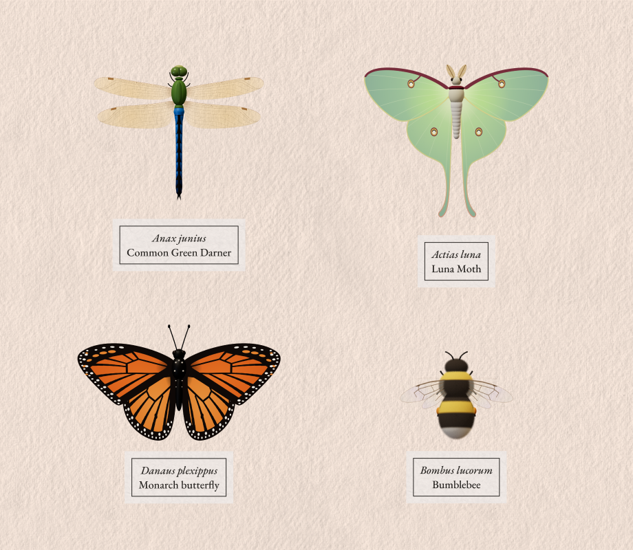

# Entomon

Realistic 3D insect cursors for the web — a transparent Three.js overlay hides the native pointer while each species keeps its own model, wing kinematics, and motion tuning on a shared interaction controller.



## Tech stack

TypeScript and [Vite](https://vite.dev/) for the app and inject bundles; [Three.js](https://threejs.org/) for the transparent overlay, procedural wing textures, and shadows; a small motion layer (springs + pointer states) with no UI framework. Local Wikipedia previews go through `vite.wiki.ts`; shipped cursors can load via a Chrome MV3 extension. High-res PNG stills use Playwright. The only runtime npm dependency is **three**.

## Local preview (Wikipedia proxy)

```bash
npm install
npm run dev
```

The dev server proxies [en.wikipedia.org](https://en.wikipedia.org) so previews run on real article pages (CSP stripped, assets rewritten). The cursor script is injected automatically.

| Insect | Article | URL |
| --- | --- | --- |
| Monarch butterfly | Butterfly | http://localhost:5173/wiki/Butterfly |
| Common Green Darner | Dragonfly | http://localhost:5173/wiki/Dragonfly |
| Luna moth | Luna moth (dark mode) | http://localhost:5173/wiki/Luna_moth |
| Bumblebee | Bumblebee (dark mode) | http://localhost:5173/wiki/Bumblebee |

Shortcuts: `/` → Butterfly, `/dragonfly` → Dragonfly, `/luna-moth` → Luna moth, `/bumblebee` → Bumblebee. The Luna moth and Bumblebee articles are always served in Wikipedia's night theme.

**Which insect?** By default the slug picks the species (`Butterfly` → monarch, `Dragonfly` / `Common_green_darner` / `Anax_junius` → dragonfly, `Luna_moth` / `Actias_luna` → luna moth, `Bumblebee` / `Bombus` → bumblebee). Following links in the same tab keeps that insect; open another mapped article (or `?entomon=…`) to switch. Override anywhere with `?entomon=monarch`, `?entomon=dragonfly`, `?entomon=luna-moth` or `?entomon=bee`.

Motion lab (buttons and fields, no Wikipedia chrome): http://localhost:5173/lab.html

**Marketing stills** (transparent PNG + SVG wrapper): [`assets/cursor-stills/`](assets/cursor-stills/). Regenerate with `npm run export:cursors` (requires dev server or Playwright will start one).

### Interaction states

All cursors share the same states: idle hover, cruise, dart on fast moves, slower wide-wing hover over links and controls, wing clap and dip on press, soft settle on release, and follow while dragging. Wings flap in every state; cruise adds occasional flat-wing glides. The luna moth's hindwing tails whip and trail behind each wingbeat. The bumblebee never glides: its coupled wings buzz fore and aft in a near-flat stroke over a shell-fur body.

## Live wikipedia.org

```bash
npm run build:inject
```

Load unpacked **`extension/`** in Chrome (`chrome://extensions`), then open a mapped article or click the Entomon toolbar icon on any Wikipedia tab.

## Build

```bash
npm run build          # playground bundle
npm run build:inject   # extension content script → dist/inject.js
```

## Layout

- `src/motion/` — pointer follow, heading, flap profiles, click/drag states
- `src/insects/<id>/` — per-species config, procedural textures, Three.js rig
- `src/render/` — orthographic overlay renderer, shared soft shadows
- `vite.wiki.ts` — Wikipedia HTML proxy for dev
- `extension/` — MV3 wrapper around the inject bundle
